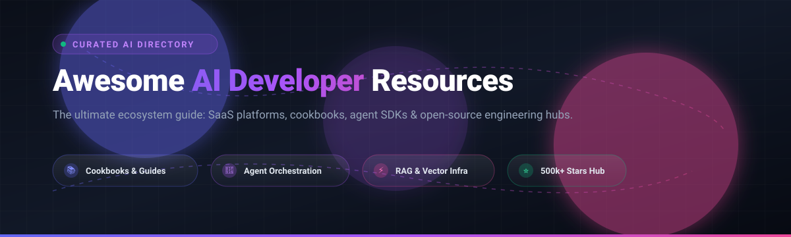

# 🚀 Awesome AI Developer Resources

  

  
  
  
  
  
  

---

## 🌟 Overview & Ecosystem Guide

Welcome to **Awesome AI Developer Resources** — a community-curated directory tracking high-impact **SaaS learning environments**, **production cookbooks**, **agent orchestration SDKs**, and **open-source AI development tools**. 

Whether you are architecting Retrieval-Augmented Generation (RAG) pipelines, building autonomous multi-agent swarms with MCP (Model Context Protocol), fine-tuning models using RLHF/DPO, or establishing enterprise evaluation frameworks, this guide connects you directly with the canonical code repositories and hands-on platforms.

> **Last updated:** October 2026 | **Contributions:** PRs & issues welcome!

---

## 📑 Table of Contents

- [📊 Sector Overview & Market Dynamics](#-sector-overview--market-dynamics)
- [☁️ SaaS / Hosted Platforms](#️-saas--hosted-platforms)
- [🛠️ Open-Source GitHub Projects](#️-open-source-github-projects)
  - [Top Repositories by Stars](#top-repositories-by-stars)
  - [Specialized Ecosystem Frameworks & Tools](#specialized-ecosystem-frameworks--tools)
- [🤝 How to Contribute](#-how-to-contribute)
- [💖 Support & Sponsorship](#-support--sponsorship)
- [📈 Star History](#-star-history)
- [⚠️ Disclaimer](#️-disclaimer)

---

## 📊 Sector Overview & Market Dynamics

The global AI developer tools and learning platforms market is evaluated at **$7.4B–$7.9B in 2025** and projected to exceed **$10B by 2026**, expanding at an aggressive CAGR of ~24–27%. 

The sector is **moderately fragmented and hyper-competitive**, driven by rapid open-source foundation model releases and modular engineering preferences. Rather than consolidating into a winner-take-all monopoly, the landscape is organized across specialized layers:
1. **Hyperscale Cloud & Compute Providers** (e.g., Google Cloud, AWS) supplying compute infrastructure and certification labs.
2. **Enterprise Foundation Model Creators** (e.g., OpenAI, Anthropic, Cohere) publishing canonical cookbooks and SDK interfaces.
3. **Specialized Vector & Retrieval Infrastructure** (e.g., Pinecone) optimizing semantic search for RAG.
4. **Independent AI Education & Evaluation Hubs** (e.g., DeepLearning.AI, AgentCompass) providing developer training and rigorous system grading.

---

## ☁️ SaaS / Hosted Platforms

A side-by-side comparison of hosted AI developer training, compute, and prototyping platforms, ordered by company scale (valuation / market capitalization):

| Platform | Description | Company Valuation / Revenue | Pricing (Starting Paid Tier) | Free Tier / Trial Limits |
| :--- | :--- | :--- | :--- | :--- |
| **[Google Cloud Skills Boost](https://www.cloudskillsboost.google/)** | 🎓 Comprehensive cloud training platform with 700+ hands-on labs, interactive sandboxes with temporary live GCP credentials, and verifiable skill badges. | Alphabet: **$2.2T+ Market Cap** (~$350B Annual Revenue) | **$29/month** (or $299/year via Innovators Plus) | **35 free lab credits/month** on the no-cost Starter tier; select introductory courses & videos permanently free. |
| **[Kaggle Learn](https://www.kaggle.com/learn)** | 📊 Leading hands-on data science & ML platform with 17+ interactive micro-courses running in browser notebooks. | Alphabet Subsidiary (Backed by Alphabet's **$2.2T+ Market Cap**) | **$0/month** (Core learning catalog is 100% free; optional compute scaling via GCP) | **30 hours/week** free GPU compute (NVIDIA T4/P100), **20 hours/week** TPU compute, 20GB disk storage, and max 9–12h per notebook session. |
| **[Cohere LLM University](https://cohere.com/developers)** | 🏛️ Enterprise LLM training hub featuring guides, hands-on tutorials, API playgrounds, and model orchestration recipes. | **$7.0B Valuation** (~$240M ARR) | Pay-as-you-go production API starting at **$0.15/1M input tokens** (Command R7B) | **1,000 API calls/month** permanently free trial key for non-production evaluation across endpoints (capped at 20 req/min for Chat, 10 req/min for Rerank). |
| **[Pinecone Learn](https://www.pinecone.io/learn/)** | 🌲 Vector database learning hub and RAG academy featuring sample apps and runnable Jupyter notebooks. | **$750M Valuation** (~$14M–$26M Annual Revenue) | **$20/month** (Builder Plan) | **2 GB storage** (approx. 100,000 vectors with 1536-dim embeddings), **2M Write Units/month**, and **1M Read Units/month** on the permanent Starter free tier (AWS us-east-1). |
| **[DeepLearning.AI](https://www.deeplearning.ai/)** | 🧠 AI education platform co-created with top AI industry leaders (OpenAI, Google, AWS, Anthropic), with 150+ specialized courses. | **~$52M–$78M Annual Revenue** (~$40M+ cumulative Coursera direct share; bootstrapped/AI Fund) | **$30/month** (or $25/month billed annually at $300/year for Pro Membership) | **Permanent free video auditing** across all course lectures and short courses; coding workspaces, graded assignments, and verifiable certificates require paid tier. |

---

## 🛠️ Open-Source GitHub Projects

Open-source repositories providing canonical cookbooks, agent frameworks, serving engines, and developer tooling.

### Top Repositories by Stars

*Sorted in descending order by GitHub stargazers count:*

1. **[ollama/ollama](https://github.com/ollama/ollama)**   
   ⚡ **Run large language models locally.** Get up and running with Llama 3, Mistral, Gemma, and custom models with a lightweight CLI and local REST API server.

2. **[huggingface/transformers](https://github.com/huggingface/transformers)**   
   🤗 **State-of-the-art Machine Learning for Pytorch, TensorFlow, and JAX.** The standard model library with 500,000+ model checkpoints across text, vision, audio, and multimodal pipelines.

3. **[langchain-ai/langchain](https://github.com/langchain-ai/langchain)**   
   🦜🔗 **The foundational framework for building context-aware reasoning applications.** Powers prompt chaining, tool calling, document loaders, vector stores, and LangSmith observability integrations.

4. **[vllm-project/vllm](https://github.com/vllm-project/vllm)**   
   🚀 **High-throughput and memory-efficient LLM serving engine.** Utilizes PagedAttention, continuous batching, and chunked prefill to maximize GPU inference throughput in production.

5. **[modelcontextprotocol/servers](https://github.com/modelcontextprotocol/servers)**   
   🔌 **Reference implementations for the Model Context Protocol (MCP).** Canonical servers connecting LLMs and agent runtimes to local filesystems, Git, PostgreSQL, Brave Search, Slack, and external services.

6. **[openai/openai-cookbook](https://github.com/openai/openai-cookbook)**   
   📖 **Examples and guides for using the OpenAI API.** Canonical recipes for function calling, embeddings, RAG pipelines, whisper transcription, vision workflows, and fine-tuning.

7. **[anthropics/anthropic-cookbook](https://github.com/anthropics/anthropic-cookbook)**   
   📕 **Copy-able code snippets and guides for Claude.** Production patterns for tool use, citations, sub-agent orchestration (e.g., Haiku sub-agents with Opus), Voyage embeddings, and vision processing.

8. **[run-llama/llama_index](https://github.com/run-llama/llama_index)**   
   🗂️ **Data framework for LLM applications and complex RAG.** Provides data connectors (LlamaHub), semantic indexing, structured query engines, and agentic retrieval strategies.

9. **[langchain-ai/langgraph](https://github.com/langchain-ai/langgraph)**   
   🕸️ **Build resilient language agents as cyclical graphs.** Designed for multi-agent workflows, human-in-the-loop controls, time-travel debugging, and fault-tolerant agent state machines.

10. **[anthropics/prompt-eng-interactive-tutorial](https://github.com/anthropics/prompt-eng-interactive-tutorial)**   
    🎯 **Interactive prompt engineering tutorial by Anthropic.** Hands-on exercises teaching chain-of-thought, XML tags structuring, role prompting, and avoiding hallucinations.

11. **[sgl-project/sglang](https://github.com/sgl-project/sglang)**   
    ⚡ **Fast serving engine for LLMs and vision-language models.** Features RadixAttention for automatic KV cache reuse across complex multi-turn chats, structured decoding, and reasoning loops.

12. **[openai/openai-agents-python](https://github.com/openai/openai-agents-python)**   
    🤖 **A lightweight, multi-agent orchestration framework.** Implements primitives like Agent, Guardrail, Session, Handoff, and Tracing with minimal abstractions.

13. **[anthropics/courses](https://github.com/anthropics/courses)**   
    🎓 **Educational courses built by Anthropic.** Official developer curricula covering the Claude API, prompt engineering, tool use, and computer use.

14. **[huggingface/trl](https://github.com/huggingface/trl)**   
    🧬 **Train transformer language models with reinforcement learning.** Full post-training pipeline supporting SFT, GRPO, DPO, PPO, and RLHF with vLLM acceleration.

15. **[meta-llama/llama-recipes](https://github.com/meta-llama/llama-recipes)**   
    🦙 **Fine-tuning, synthetic data generation, and inference examples for Llama models.** Official recipes for PEFT/LoRA, vLLM deployment, and quantization.

16. **[anthropics/anthropic-quickstarts](https://github.com/anthropics/anthropic-quickstarts)**   
    🚀 **Ready-to-deploy reference applications built with Claude.** Full-stack starter templates including customer support agents, financial data analysts, and computer use demos.

17. **[GoogleCloudPlatform/generative-ai](https://github.com/GoogleCloudPlatform/generative-ai)**   
    🌐 **Sample code and notebooks for Generative AI on Google Cloud.** Official guides for Gemini API, Vertex AI SDK, Imagen, multimodal embeddings, and vector search.

18. **[modelcontextprotocol/specification](https://github.com/modelcontextprotocol/specification)**   
    📜 **The open standard specification for Model Context Protocol (MCP).** Protocol schema definitions, lifecycle requirements, and transport specifications.

19. **[open-compass/opencompass](https://github.com/open-compass/opencompass)**   
    📏 **Comprehensive evaluation platform for large language and multimodal models.** Features 100+ datasets, objective metrics, subjective LLM-as-judge scoring, and leaderboard generation.

20. **[huggingface/huggingface_hub](https://github.com/huggingface/huggingface_hub)**   
    📦 **Client library for the Hugging Face Hub.** Enables seamless downloading, managing, and uploading of model weights, datasets, and Spaces from Python.

21. **[openai/openai-agents-js](https://github.com/openai/openai-agents-js)**   
    💻 **Official TypeScript baseline for agent orchestration.** Multi-agent handoffs, sandboxed environments, real-time voice integration, and tracing.

22. **[hwchase17/langchain-hub](https://github.com/hwchase17/langchain-hub)**   
    🗃️ **Community repository for sharing prompts, chains, and agents.** Browse, download, and iterate upon prompt templates across popular LLM architectures.

23. **[pinecone-io/examples](https://github.com/pinecone-io/examples)**   
    🌲 **Sample applications and Jupyter Notebooks for vector databases.** Runnable examples for hybrid search, multimodal retrieval, chunking strategies, and RAG evaluation.

24. **[aws-samples/amazon-bedrock-workshop](https://github.com/aws-samples/amazon-bedrock-workshop)**   
    ☁️ **Hands-on workshop for building with Amazon Bedrock.** Scaffolding for Bedrock Knowledge Bases, Agents, CDK infrastructure, and reference UI templates.

25. **[open-compass/AgentCompass](https://github.com/open-compass/AgentCompass)**   
    🧭 **Unified open-source evaluation infrastructure for agentic workflows.** Provides 30+ benchmarks and 10+ agent harnesses (including Claude Code, Codex, and OpenHands).

---

### Specialized Ecosystem Frameworks & Tools

- **[Model Context Protocol (MCP)](https://modelcontextprotocol.io/)** — Open standard defining how models query context, invoke tools, and operate async tasks. Adopted by Claude Code, Cursor, and IDE ecosystems.
- **[ContextForge Eval](https://pypi.org/project/contextforge-eval/)** — Framework-agnostic agent grading library detecting stale facts, loops, and context degradation.
- **[Claude Code Best Practices](https://code.claude.com/docs/en/best-practices)** — Production guide on structuring `CLAUDE.md`, permission sandboxing, and connecting custom MCP servers.
- **[Gemini Developer Documentation](https://ai.google.dev/gemini-api/docs)** — Direct guides for Gemini 2.5/Flash, multimodal context caching, audio/video streaming, and structured JSON outputs.
- **[ishandutta2007/Awesome-Awesome-Awesome](https://github.com/ishandutta2007/Awesome-Awesome-Awesome)** — Master index of awesome lists for developers, engineers, and researchers.

---

## 🤝 How to Contribute

Contributions are warmly welcomed! Help keep this ecosystem guide updated and comprehensive:

1. 🍴 **Fork the repository**.
2. 🌿 **Create a descriptive branch** (`git checkout -b add-resource-name`).
3. 📝 **Add your resource** following the existing table or list format (include name, URL, Stars_Badge, and concise description).
4. 📬 **Submit a Pull Request** with context on why this resource benefits AI developers.

---

## 💖 Support & Sponsorship

If you found this curated list helpful for your AI engineering journey, please consider supporting the project:

- ⭐ **Star this repository** to improve visibility for other developers.
- 🍴 **Fork and share** with your teammates and community.
- ☕ **Sponsor the maintainer** via the [GitHub Sponsors Dashboard](https://github.com/sponsors/ishandutta2007) to support continuous updates and curation!

---

## 📈 Star History

---

## ⚠️ Disclaimer

- This is a **community-curated collection** — inclusion does not represent an endorsement.
- Cookbook code snippets and open-source recipes provide architectural guidance; ensure appropriate security hardening, API secret encryption, rate-limiting, and error fallback before production deployment.
- Pricing, free tier allowances, and Stars_Counts reflect verified platform documentation as of October 2026.

---

  <b>Built with ❤️ for AI engineers, ML researchers, and autonomous agent builders worldwide.</b>

